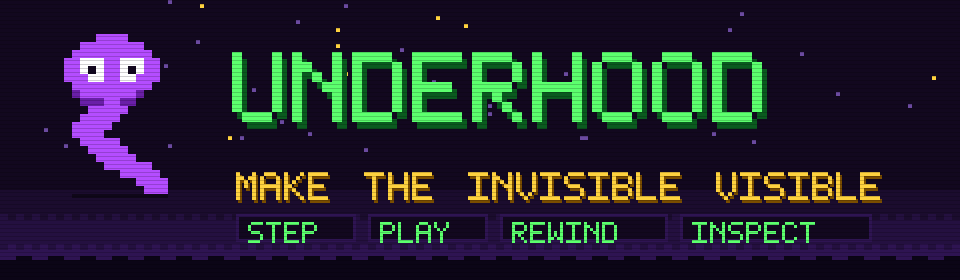

<p align="center">
  
</p>

<p align="center">
  <b>The interactive laboratory where software engineering concepts run in slow motion.</b><br/>
  Pause them. Rewind them. Poke their insides. Change the input and watch what breaks.
</p>

<p align="center">
  <code>make dev</code> &nbsp;·&nbsp; <code>make test</code> &nbsp;·&nbsp; <code>make help</code>
</p>

---

## Why Underhood?

Most explanations of hash tables, embeddings or consensus protocols are a static diagram and a wall of text. You read *that* it works, but you never see *how*: which byte was compared, why the probe stopped there, what the state looked like one step ago.

Underhood turns each concept into a **deterministic simulation you can drive like a debugger**:

| You can… | …so you finally understand |
|---|---|
| ⏯ **Play, pause, step forward and backward** | the exact order of events, and what each one changed |
| 🔍 **Inspect the internal state at every step** | the real data layout, not a cartoon of it |
| ✍️ **Edit the input and re-run** | edge cases: collisions, tombstones, zero vectors |
| 🧷 **Set breakpoints on the timeline** | jump straight to the interesting moment (a resize, a false positive) |
| 💻 **See the code line that is executing** | how the algorithm maps to visuals |
| ❓ **Read *what*, *why*, *input* and *expected output* for every step** | the reasoning, not just the result |

> **Make the invisible visible.**

## What's inside

### Concepts

| Concept | Category | What you'll see |
|---|---|---|
| **Swiss Tables** | Data Structures · Advanced | Hash split into H1/H2, control bytes (`FULL` / `EMPTY` / `DELETED`), SIMD-style group comparison, false positives, mirrored tail bytes, tombstones, growth vs. in-place rehash. Modelled on Abseil and Rust's `hashbrown`. |
| **Embeddings** | Machine Learning · Beginner | Vectors as points, dot product, norms, cosine vs. Euclidean (and why stretching a vector changes only one), nearest neighbours, analogies, PCA in 2D/3D. Draggable vectors. |
| **Binary Search** | Algorithms · Beginner | A compact reference concept (also the worked example in the tutorial below). |

More are a prompt away — see [Add your own concept](#add-your-own-concept).

### The lab

- **Hierarchical sidebar** with search, auto-built from the concept catalog
- **Visualization canvas** with the largest share of the screen
- **Explanation panel** — what is happening, why, input, expected output
- **Code panel** with the active lines highlighted in sync
- **Timeline** of every step, click-to-jump, right-click to set a breakpoint
- **Playback controls** and speed control (¼× – 4×)
- **Dark-first** design with a light theme, keyboard shortcuts, reduced-motion support

| Key | Action |
|---|---|
| `Space` | play / pause |
| `←` `→` | previous / next step |
| `R` | restart |
| right-click / shift-click a tick | toggle breakpoint |

### Honest by design

Every concept ships an **Assumptions** tab that lists each simplification and implementation-specific detail, and a **References** tab pointing at the real sources. Illustrative data is always labelled as such — the Embeddings lab uses 6 hand-authored dimensions and says so, instead of pretending to be a 3072-D model.

## Quick start

Requires Node 20+ and `make` (or run the `npm` equivalents).

```bash
make install     # install dependencies
make dev         # http://localhost:5173
```

### Make targets

| Target | Description |
|---|---|
| `make help` | list all targets |
| `make install` | install dependencies |
| `make dev` | dev server with hot reload |
| `make build` | typecheck + production build into `dist/` |
| `make preview` | serve the production build |
| `make test` | run all tests once |
| `make test-watch` | tests in watch mode |
| `make typecheck` | strict TypeScript check |
| `make check` | everything CI runs: typecheck + tests + build |
| `make new-concept ID=… TITLE=… DIR=…` | scaffold a new concept |
| `make logo` | regenerate the pixel-art logo |
| `make clean` / `make distclean` | remove build output / also `node_modules` |

## How it works

```
Concept ──► Simulation.run(input) ──► Step[]   pure · deterministic · full before/after state
                                        │
   player store (index, speed, breakpoints)   timers live only in useTicker
                                        ▼
   View = composition of primitives, synchronised through highlight ids (ctrl:3, pt:king…)
```

- **Simulation engine** (`src/engine`) is independent from React. A simulation returns its *entire* list of steps up front, each with its full `before` and `after` state — so stepping backwards is just indexing, and playback speed never influences logic.
- **Primitives** (`src/primitives`) are the LEGO bricks: `ArrayView`, `MemoryBlock`, `VectorView`, `CoordinateSystem` (2D / rotatable 3D), `GraphView`, `TreeView`, `CodePanel`, inspectors, annotations. They never know about steps; they only ask "am I highlighted?".
- **Concepts** (`src/concepts/**`) are self-contained modules. The **registry** discovers them automatically — the sidebar, routes, breadcrumbs and related links are all derived from the catalog.
- **Quality gates** run on *every* registered concept: determinism, step consistency (`before(n) = after(n-1)`), reversibility, input immutability, and **every highlight must exist in the rendered DOM at its step**.

Deeper dive: [docs/architecture.md](docs/architecture.md).

---

## Add your own concept

There are two ways. Most contributors should use the first.

### Option A — Ask Claude Code (`/add-concept`)

In this repository, run Claude Code and describe what you want in natural language:

```text
/add-concept Add an interactive visualization explaining how a B-Tree works,
including insertion, splitting, searching and deletion.
```

The agent workflow (see [`.claude/`](.claude)) goes through:

1. **Understand & clarify** — asks you when a critical detail is missing instead of inventing it.
2. **Research** (`concept-researcher`) — papers, official docs and reference implementations; every claim mapped to a source.
3. **Proposal** (`technical-architect`) — scope, objectives, sources, execution model, visualization, reusable primitives, plan. **It stops here for your approval.**
4. **Implement** (`simulation-engineer`, `visualization-composer`, `educational-content-writer`).
5. **Validate** (`qa-validator`) — correctness, determinism, reversibility, visual sync, accessibility, reuse. A page that merely renders is *not* done.

### Option B — By hand: a 10-minute tutorial

We'll build **Binary Search**. It already exists in the repo as a working reference: [`src/concepts/algorithms/binary-search`](src/concepts/algorithms/binary-search). Follow along with a different name to practise.

#### Step 0 — Scaffold

```bash
make new-concept ID=binary-search TITLE="Binary Search" DIR=algorithms/binary-search
```

(Binary Search already exists in this repo, so the scaffolder refuses to overwrite it — use another `ID`/`DIR` to follow along.) This creates `src/concepts/algorithms/binary-search/` with `concept.ts`, `simulation.ts`, `code.ts`, `presets.ts`, `View.tsx` and a test. The concept is **already registered**: reload the app and it appears in the sidebar under its category. The scaffold is full of `TODO(concept)` markers — `make test` fails until they're all gone, so nothing half-finished slips through.

#### Step 1 — Model the state and the input (`simulation.ts`)

The *state* is everything the visualization needs to draw one frame. Keep it **plain JSON** (no classes, `Map`s or functions): snapshots must compare with `toEqual`.

```ts
export interface BinarySearchInput { items: number[]; target: number }

export interface BinarySearchState {
  items: number[]
  lo: number
  hi: number
  mid: number | null
  result: number | null
}
```

#### Step 2 — Write the step generator

`run(input)` must be **pure and deterministic**: no `Date`, no `Math.random`, no timers. Use `StepRecorder`, which guarantees `before(n) === after(n-1)`.

```ts
const rec = new StepRecorder<BinarySearchState>(initialState)

rec.push(
  {
    title: `Compare items[${mid}] = ${v} with ${target}`,
    explanation: `${v} is smaller than ${target}, so the target can only be in the right half.`,
    why: 'The array is sorted, so everything on the other side can be discarded.',
    input: `lo=${lo}, hi=${hi}, mid=${mid}`,
    output: `lo = ${mid + 1}`,
    highlights: [{ target: `cell:${mid}`, role: 'read', label: 'mid' }],
    code: { lines: listing.line('mid') },
  },
  nextState,                       // the state AFTER this step
)
return rec.build()
```

Every step needs `title`, `explanation`, `why`, `input` and `output`. **Highlights** are the contract between simulation and visuals: a `target` id (`cell:3`) plus a role (`active`, `match`, `conflict`, `read`, `write`, `dim`).

> 💡 For non-trivial algorithms, put the real logic in `domain.ts` and have it emit *events* through an observer; the simulation turns events into steps. That way the explanation can never drift from the implementation (this is how Swiss Tables is built).

#### Step 3 — Annotate the code (`code.ts`)

Mark lines with `// @label` and reference them by name — never by line number:

```ts
export const listing = parseAnnotatedSource(`function binarySearch(items, target) {
  let lo = 0, hi = items.length - 1       // @init
  while (lo <= hi) {                      // @loop
    const mid = (lo + hi) >> 1            // @mid
    if (items[mid] === target) return mid // @hit
    ...`)
```

Steps then say `code: { lines: listing.line('mid') }` and the code panel highlights those lines.

#### Step 4 — Compose the view from primitives (`View.tsx`)

```tsx
export function BinarySearchView({ state }: ConceptViewProps<BinarySearchState, BinarySearchInput>) {
  return (
    <div className="flex flex-col gap-4">
      <ArrayView items={state.items} idPrefix="cell" label="sorted array" />
      <VariableInspector rows={[{ name: 'lo', value: state.lo }, { name: 'hi', value: state.hi }]} />
    </div>
  )
}
```

`ArrayView idPrefix="cell"` gives every cell the id `cell:<index>`, which is exactly what the simulation highlights. Reach for an existing primitive first (`MemoryBlock`, `VectorView`, `CoordinateSystem`, `GraphView`, `TreeView`, `ComparisonView`, `MatrixView`…). Only add a new one to `src/primitives` if none fits, and make it generic.

Need user input? Add an `InputEditor` component to the concept (see Swiss Tables or Embeddings), or call `onInputChange` from inside the view to let users drag things on the canvas.

#### Step 5 — Presets, including edge cases (`presets.ts`)

```ts
export const presets: Preset<BinarySearchInput>[] = [
  { id: 'hit',    label: 'Target present',         input: { items: sorted, target: 23 } },
  { id: 'miss',   label: 'Edge case: absent',      edgeCase: true, input: { items: sorted, target: 40 } },
  { id: 'single', label: 'Edge case: one element', edgeCase: true, input: { items: [7], target: 7 } },
]
```

#### Step 6 — Fill in the manifest (`concept.ts`)

```ts
export default defineConcept<BinarySearchState, BinarySearchInput>({
  meta: { id: 'binary-search', title: 'Binary Search', summary: '…',
          category: ['Algorithms', 'Searching'], difficulty: 'beginner',
          prerequisites: [], related: [] },
  objectives: ['…'],
  sections: [ /* introduction, mental-model, architecture, edge-cases, complexity, applications */ ],
  assumptions: ['Every simplification and implementation-specific detail goes here.'],
  references: [ /* real sources you actually read */ ],
  simulation: BinarySearchSimulation, presets,
  code: { language: 'typescript', source: CODE },
  View: BinarySearchView,
  validateInput: ({ items }) => (isSorted(items) ? null : 'The array must be sorted.'),
})
```

The `category` array is the navigation path: `['Algorithms', 'Searching']` creates (or reuses) the *Algorithms → Searching* branch in the sidebar. No navigation file to edit.

> ⚠️ **Never fabricate sources or technical claims.** Open and read every reference; list anything you simplified under `assumptions`.

#### Step 7 — Test the *behaviour*, not just the shape

The generic contract tests (determinism, step consistency, reversibility, highlight targets rendered) run on your concept automatically. Add domain tests for what makes *your* concept correct:

```ts
it('matches indexOf on every element and on absent values', () => {
  const items = Array.from({ length: 40 }, (_, i) => i * 3)
  for (let t = -2; t < 125; t++) expect(result(items, t)).toBe(items.indexOf(t))
})
```

Oracles, invariants and randomized sequences against a naive reference are the strongest tests available.

#### Step 8 — Verify

```bash
make check       # typecheck + all tests + production build
make dev         # then actually play it: step, rewind, edit input, try the edge-case presets
```

#### Concept checklist

- [ ] `make check` is green and no `TODO(concept)` remains
- [ ] Every step has title, explanation, why, input, output — and they match the real state
- [ ] Edge-case presets exist (`edgeCase: true`)
- [ ] The view is built from primitives
- [ ] `assumptions` and `references` are honest and complete
- [ ] You tried it in the browser, including a narrow window and the light theme

More detail: [docs/adding-a-concept.md](docs/adding-a-concept.md) · conventions for agents and contributors: [.claude/CLAUDE.md](.claude/CLAUDE.md).

---

## Project layout

```
src/
  engine/        simulation contracts, playback reducer, player store, test contracts
  primitives/    reusable visual building blocks
  concepts/      one folder per concept (auto-registered)
  registry/      concept discovery + catalog validation
  components/    application shell (sidebar, header, timeline, panels)
.claude/         CLAUDE.md, /add-concept skill, specialist agents
scripts/         concept scaffolding, logo generator
docs/            architecture and contributor docs
```

## Stack

React · TypeScript (strict) · Vite · Tailwind CSS · Motion · Zustand · Vitest

## Status & limits

Layout and animation have been verified through the build and the test-suite, but not through automated visual regression tests. The 3D view is a custom SVG projection, not WebGL. Concepts are only as accurate as their listed assumptions — read them.
